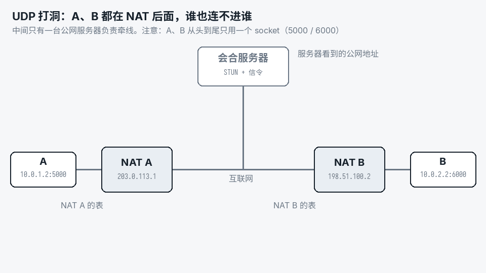

# 两台 NAT 后面的电脑怎么直连：UDP 打洞原理 + Go 实现，附一个能直接用的 P2P 工具

先看一组我自己测的数字。两台家宽电脑之间，用 ssh 管道传 100MB：

| 路径 | 速度 |
|---|---|
| 远控软件的端口转发（打洞失败，退回中继服务器） | 3.4 Mbps |
| 打洞直连 | **167 Mbps** |

中继慢，是因为所有流量都要绕服务器一圈，速度被服务器带宽卡死（我的服务器出方向只有 3M）。直连就没有这个上限，也不花服务器流量。

问题是两台电脑都在路由器（NAT）后面，谁也没有公网 IP，怎么直连？答案是 **UDP 打洞**。本文先用几段话讲清原理，配一张动图，然后讲关键的 Go 代码（STUN、信令服务器、打洞、QUIC 接管），最后给出一个现成的工具 `p2pcp`：一条命令打洞传文件，或者把远端的端口转发到本地。

## 1. 基础：NAT 是一张表

家里的电脑 `10.0.1.2:5000` 往外发一个 UDP 包，路由器把源地址改成自己的公网地址，比如 `203.0.113.1:40000`，并在表里记一行：

```
内网 10.0.1.2:5000  ⇄  公网 203.0.113.1:40000     放行：发去过的地址
```

外面的包打到 `203.0.113.1:40000` 时，路由器查表：有对应的行就转给内网，没有就丢掉。这就是为什么「外面连不进来」。

NAT 之间的差别就在这张表的两个细节上：

- **映射**：同一个内网端口发往不同的目的地，公网端口变不变？不变叫「锥形」，变了叫「对称型」。
- **过滤**：外面来的包要核对什么才放行？什么都不核对、只核对 IP、核对 IP + 端口，分别对应俗称的 NAT1、NAT2、NAT3。对称型俗称 NAT4。

国内家宽路由器和手机 4G/5G 绝大多数是 NAT3：映射不变，过滤最严，要核对 IP 和端口。好消息是 NAT3 和 NAT3 之间能打通。

打洞要用到三个角色，别搞混：

| 角色 | 干什么 | 必须有吗 |
|---|---|---|
| STUN | 一面镜子：告诉你「我看到你的公网地址是 X」 | 要有（或者由信令服务器顺手做） |
| 信令 | 传话：把双方的公网地址转告给对方 | 必须有 |
| 中继（TURN） | 打不通时帮你转发所有数据 | 兜底用 |

前两个只在建立连接的头几百毫秒用到，之后数据直连。所以一台很小的服务器就够用。

## 2. 原理：打洞四步



1. **注册**：A、B 分别向服务器发一个包。服务器看到的源地址，就是 NAT 改写后的公网地址。
2. **交换地址**：服务器把 B 的公网地址告诉 A，把 A 的告诉 B。
3. **A 往 B 的公网地址发包**：包出 NAT A 时，NAT A 记下「放行 B」。包到了 NAT B，B 的表里没有「放行 A」，丢弃。
4. **B 往 A 的公网地址发包**：NAT B 记下「放行 A」。包到了 NAT A，正好匹配第 3 步开的门，进来了。A 回一个包，NAT B 也认，洞就通了。

两个要点：

- **自己发的包是给自己开门的**，真正穿过去的是对方的包。所以两边都要发，谁先谁后无所谓，第一个包被丢也没关系。
- **注册和打洞必须用同一个 socket**。换一个 socket 就换了本地端口，NAT 会新开一行映射，服务器告诉对方的地址就不再指向你了。打通之后，传数据也要继续用这个 socket。

什么时候打不通：两边都是对称型（NAT4 ↔ NAT4），或者一边对称、一边 NAT3。对称型 NAT 往不同的目的地发包会换端口，服务器看到的端口对别人无效。这时只能走中继。实际遇到的不多，但工具必须兜底。

## 3. 架构

```
           ┌──────────── 会合服务器（一台小 VPS）────────────┐
           │  UDP 7001：STUN + 信令（镜子 + 传话）            │
           │  UDP 3478：中继（打不通时兜底）                  │
           └───────────▲──────────────────────▲──────────────┘
                       │ 注册 / 拿对方地址      │
   ┌───────────────────┴───┐            ┌─────┴─────────────────┐
   │ 发送端                 │            │ 接收端                 │
   │ ① 会合 + 打洞（rdv.go）│  打通的洞  │ ① 会合 + 打洞          │
   │ ② QUIC 接管同一个 socket│◀═════════▶│ ② QUIC 接管同一个 socket│
   │ ③ 房间密钥认证（auth.go）│  直连 UDP  │ ③ 房间密钥认证          │
   │ ④ 传文件 / 端口转发     │            │ ④ 收文件 / 暴露端口     │
   └───────────────────────┘            └───────────────────────┘
```

打通的只是一条「能互发 UDP 包」的路。UDP 会丢包、乱序、没有加密，所以在这条路上跑 QUIC：可靠传输、拥塞控制、TLS 1.3 加密、一条连接里多路并发的流，全都有了。

下面按这个顺序看代码。完整代码在文末的仓库里，这里贴的是去掉错误处理之后的核心部分。

## 4. 代码

### 4.1 STUN：20 字节的镜子

STUN 请求只有一个 20 字节的头：

```
0x0001 (Binding Request) | 长度 0 | 魔数 0x2112A442 | 12 字节随机事务 ID
```

服务器的回应带一个 `XOR-MAPPED-ADDRESS` 属性，内容是「我看到的你的 IP:端口」。服务端实现就这么几行：

```go
// bindingResponse 回应 req，告诉对方：我看到你的地址是 from
func bindingResponse(req []byte, from *net.UDPAddr) []byte {
	ip := from.IP.To4()
	b := make([]byte, 32)
	binary.BigEndian.PutUint16(b[0:], 0x0101) // Binding Success Response
	binary.BigEndian.PutUint16(b[2:], 12)     // 属性总长
	copy(b[4:20], req[4:20])                  // 原样带回魔数和事务 ID
	binary.BigEndian.PutUint16(b[20:], 0x0020) // XOR-MAPPED-ADDRESS
	binary.BigEndian.PutUint16(b[22:], 8)
	b[25] = 0x01 // IPv4
	binary.BigEndian.PutUint16(b[26:], uint16(from.Port)^uint16(magicCookie>>16))
	binary.BigEndian.PutUint32(b[28:], binary.BigEndian.Uint32(ip)^magicCookie)
	return b
}
```

为什么地址要和魔数异或？有些路由器的 ALG 功能会扫描包里出现的自家公网 IP 并「好心」改掉，异或之后它就认不出来了。客户端收到后再异或回来即可。

公共 STUN 服务器很多（`stun.miwifi.com:3478`、`stun.chat.bilibili.com:3478` 等），用同一个 socket 问两三个不同的服务器，比较返回的端口：一样就是锥形，不一样就是对称型。`lab/stunprobe` 用 150 行做了这件事，可以先拿它测测自己的网络。

### 4.2 信令服务器：记下地址，凑齐一对就互相转告

信令服务器收到注册包时，源地址就是 NAT 改写后的公网地址，所以它顺手就把 STUN 的活干了。核心逻辑：

```go
// 报文：→ /R2 <房间号> <id> <内网候选> <标志>
//       ← /Y <你的公网地址>
//       ← /P <对方 id> <对方公网地址> <对方内网候选> <标志>
func serve(conn *net.UDPConn) {
	rooms := map[string]map[string]*member{} // 房间号 → id → 成员
	buf := make([]byte, 1500)
	for {
		n, from, _ := conn.ReadFromUDP(buf)
		f := strings.Fields(string(buf[:n]))
		if len(f) != 5 || f[0] != "/R2" {
			continue
		}
		room, id, lan := f[1], f[2], f[3]
		conn.WriteToUDP([]byte("/Y "+from.String()), from) // 镜子：告诉它我看到的地址

		if rooms[room] == nil {
			rooms[room] = map[string]*member{}
		}
		rooms[room][id] = &member{pub: from, lan: lan, seen: time.Now()}
		for oid, o := range rooms[room] {
			if oid == id || time.Since(o.seen) > 30*time.Second {
				continue
			}
			// 双向转告：两边几乎同时拿到对方地址，同时开始打洞
			conn.WriteToUDP([]byte(fmt.Sprintf("/P %s %s %s -", oid, o.pub, o.lan)), from)
			conn.WriteToUDP([]byte(fmt.Sprintf("/P %s %s %s -", id, from, lan)), o.pub)
		}
	}
}
```

几个细节：

- **内网候选**：客户端把自己网卡的地址也报上来。两台机器在同一个局域网时，直接走内网地址更快。
- **回包要从收到注册的那个端口发出去**。服务器听多个端口时，从别的端口回包，过不了对方 NAT 的过滤（NAT3 要核对端口）。
- 完整版（`lab/punch/main.go` 的 `runServer`）还做了按 IP 限速、过期清理、多端口共享房间，以及中继。

### 4.3 打洞：每 20ms 往所有候选发探测

客户端拿到对方的候选地址（公网地址 + 内网地址）后，同时往所有候选发探测包，谁先回应就用谁：

```go
// 收：对方的探测进来就回应；收到回应就是打通了
go func() {
	triggered := map[string]bool{}
	for {
		n, from, err := c.ReadFromUDP(buf)
		if err != nil {
			return
		}
		switch string(buf[:min(n, 3)]) {
		case "/PP": // 对方的探测
			c.WriteToUDP(pktAck, from)
			if !triggered[from.String()] { // 触发检查：立刻反向探测一次，不等下一个 20ms
				triggered[from.String()] = true
				c.WriteToUDP(pktPunch, from)
			}
		case "/PA": // 对方的回应：这条路通了
			choose(c, from)
			return
		}
	}
}()

// 发：每 20ms 往所有候选发一轮探测，4 秒还不通就换端口重来
tick := time.NewTicker(20 * time.Millisecond)
for {
	for _, a := range peerCands {
		c.WriteToUDP(pktPunch, a)
	}
	select {
	case <-done:
		return &session{conn: c, peer: chosen}, nil
	case <-tick.C:
	}
	if time.Now().After(deadline) {
		return nil, errPunchTimeout
	}
}
```

实测这两个细节很值：探测间隔从 200ms 改成 20ms，再加上触发检查，家宽 ↔ 5G 手机的打洞耗时从 250ms 降到 88ms，基本就是两端开始时刻之差加一个 RTT。

「4 秒不通就换端口重来」也不是多余的。有些 NAT 在对方的包先到时会留下冲突状态，这一对端口就废了，换一对新端口就好。连续两轮打不通，就改走中继。

### 4.4 QUIC 接管同一个 socket

打通的 socket 原样交给 QUIC（用的是 `quic-go`）：

```go
tr := &quic.Transport{Conn: s.conn} // 就是刚才打洞的那个 socket

// 发送端
conn, err := tr.Dial(ctx, s.peer, tlsConf, quicConf)
// 接收端
ln, err := tr.Listen(tlsConf, quicConf)
conn, err := ln.Accept(ctx)
```

有一个坑：QUIC 接管 socket 之后，对方迟到的探测包、会合服务器的回执也会进到这个 socket，不能让它们把 QUIC 搞乱。quic-go 的规矩是：首字节 `0x40` 那一位为 0 的包不是 QUIC 包，交给 `ReadNonQUICPacket`。所以我把所有打洞和信令报文都设计成以 `/`（0x2f）开头：

```go
// QUIC 管不着的包：回应迟到的探测，信令报文转给连接迁移用
for {
	n, from, err := tr.ReadNonQUICPacket(ctx, buf)
	if err != nil {
		return
	}
	if strings.HasPrefix(string(buf[:n]), "/PP") {
		tr.WriteTo(pktAck, from)
	}
}
```

`KeepAlivePeriod` 要设：NAT 的映射静默一段时间就会过期（我测的家用路由器是 60~90 秒），QUIC 每 5 秒一个保活包，洞就一直开着。

### 4.5 认证：房间名就是密钥

两端用同一个「房间名」配对。房间名不能明文出现在线路上，所以：

- 报给会合服务器的是房间号 `HMAC(密钥, "rendezvous")`，服务器和它的日志都看不到房间名；
- QUIC 证书是自签的、不校验，握手之后两端再各证明一次「我知道密钥」：`HMAC(密钥, 角色 ‖ EKM)`。EKM 是从这次 TLS 握手导出的密钥材料，每次握手都不同。中间人两头各握一次手，两边的 EKM 不一样，转发对方的证明也对不上。这叫通道绑定，不需要 CA 证书也不怕中间人。

```go
ekm, _ := conn.ConnectionState().TLS.ExportKeyingMaterial("p2pcp auth", nil, 32)
proof := func(role string) []byte { return mac(secret, []byte(role), ekm) }
// 客户端先发 proof("client")；服务端验过之后才回 proof("server")
```

## 5. 工具：p2pcp

上面这些合起来就是 `p2pcp`。需要 Go 1.26，纯 Go、没有 cgo，Linux、macOS、Android（arm64）都能直接交叉编译。【TODO：Windows 版还差信号处理一处适配】

```bash
git clone 【TODO：开源地址】 && cd 【TODO】/lab
go build ./p2pcp ./punch
GOOS=linux GOARCH=arm64 CGO_ENABLED=0 go build ./p2pcp   # 比如放到手机上用 adb 跑
```

两个子命令最常用：

**传文件**

```bash
# 接收端
p2pcp recv -server 你的服务器:7001 -room 一个别人猜不到的房间名 -o ~/下载
# 发送端
p2pcp send -server 你的服务器:7001 -room 同一个房间名 大文件.zip 另一个文件
```

断了自动重连续传，传完校验 sha256。

**端口转发**（比如让 ssh / rsync 走打洞直连）

```bash
# 远端：把本机 22 端口暴露出去
p2pcp expose  -server 你的服务器:7001 -room 房间名 -to 127.0.0.1:22
# 本机：本地 2223 端口转发到远端的 22
p2pcp forward -server 你的服务器:7001 -room 房间名 -listen 127.0.0.1:2223
ssh -p 2223 user@127.0.0.1
```

每个 TCP 连接对应 QUIC 里的一条流。打不通时自动走中继，后台继续打洞，打通了就把连接迁过去，ssh 会话不断。

**部署会合服务器**：任何一台有公网 IP 的小 VPS，安全组放行 UDP 7001 和 3478：

```bash
punch server -listen :7001 -relay :3478
```

**网络体检**：连不上时先跑 `p2pcp check`，它会测会合端口通不通、NAT 映射行为、有没有 IPv6、中继能不能用。

实测（家宽 PC ↔ 电信 5G 手机）：

| 项目 | 结果 |
|---|---|
| 打洞耗时 | 40~80ms |
| 手机 → PC 传文件 | 约 40 Mbps（5G 上行的上限是 48） |
| ssh 管道（家宽 ↔ 家宽） | 167 Mbps，中继只有 3.4 |
| 手机连续换三次网络（端口转发） | 三次都迁移成功，上面的 TCP 会话没断 |

## 6. 几个踩过的坑

- **开着 TUN 模式的代理**（sing-box、Clash）：程序拿到的「本机地址」是虚拟网卡的，打洞包也可能被代理接走。加 `-bind auto`，绑定到物理网卡。
- **运营商对个别端口有特殊处理**：我遇到过会合服务器用 UDP 7000 时，电信某台 CGNAT 后面全部打不通，换成 7001 立刻好了。所以 `-server` 可以写多个地址，轮着试。
- **保活**：映射寿命短的只有 60 秒，连接上至少每 30 秒要有一个包。
- **NAT4 ↔ NAT4 打不通**是原理决定的，只能中继。中继的速度取决于服务器带宽。

## 7. 代码

【TODO：开源地址】

- `lab/p2pcp`：本文的工具
- `lab/punch`：会合服务器 + 最小打洞 demo（打通后能互发文字）
- `lab/stunprobe`：测自己的 NAT 类型
- `lab/netns`：免 root 的 NAT 实验室，想在本机复现各种 NAT 之间的打洞情况，可以用它
